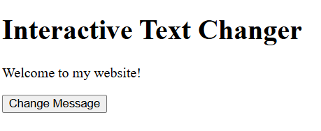
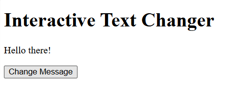
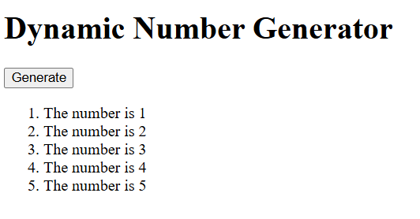

# Lab 4a: Client-Side Scripting with JavaScript

## Student Details
- Name: FITRAH ZAKIAH BINTI FAISAL
- Matric Num: AI240088
- Course: BIC21203 Web Development

## Description
This lab contains three interactive webpages developed using HTML and JavaScript that covers functions, click events, input validation, loops and DOM manipulation.

## Q1: Interactive Text Changer
The webpage initially displays “Welcome to my website!”.
Clicking “Change Message” changes the paragraph to “Hello there!”.

## Q2: Smart Number Validator
The webpage checks whether an entered number is lower than, higher than or equal to 10.
Letters, empty input and spaces only display an invalid input message. Decimal numbers are accepted.

## Q3: Dynamic Number Generator
Clicking “Generate” creates five list items showing “The number is 1” through “The number is 5”.
Existing items are cleared before generating again to prevent duplicates.

## How to Run
1. Click Code and select Download ZIP.
2. Extract the ZIP file.
3. Open the Q1, Q2 or Q3 folder.
4. Open its index.html file in a browser.
5. Use the button to test the webpage.

## Output Screenshots

### Q1: Before Clicking

### Q1: After Clicking

### Q2: Number Validation

### Q3: Generated Numbers

